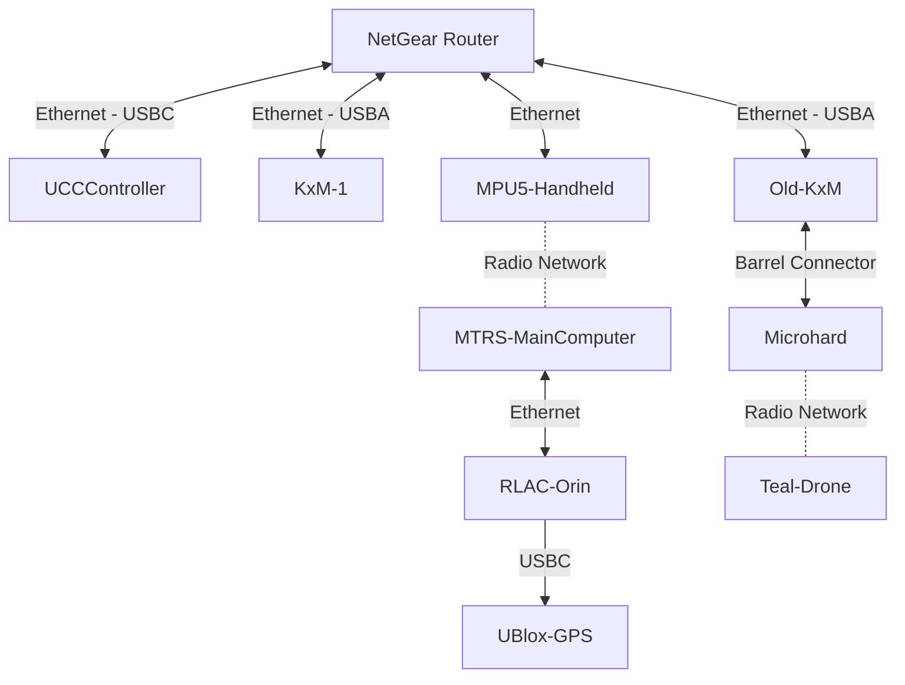
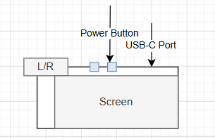

## Setting up for a Demo 

- The physical wire setup should look like this:

- About the `Ethernet - USBA` connection to KxM-1
    - The USBA side needs to go to a specific USB port
        - On the side of KxM-1 with the Ethernet port there are two USB ports next to it
        - The connection should go into the bottom USB port

- Turn on the UCCController
    - It's an android phone
    - Press and hold the button on the top (relative to the black casing)
        - There are two buttons up there, it's the one on the right
        - 

- Turn on the MTRS
    - There's a button on the front side (the side with the RLAC-Orin)
    - Press and Hold for 5 seconds (until the blue light around it starts blinking)

- Turn on the MPU5-handheld radio
    - Turn the dial on the top to 1
	- Status Lights:
		- blue:				initializing
		- green + yellow: 	looking for a connection
		- green: 			connected
		- green + red:		low/bad battery 
        - red:              see the next bullet
    - Solid red means that the radio has been factory reset
        - Follow these instructions to configure it:
        - https://aplwiki.jhuapl.edu/confluence/spaces/QNN/pages/1109492619/Configuring+MPU5+Radios
        - I'll paste the radio config and security key in the RLAC slack so that you can skip the first half
    
- Do a ping test from KxM-1
    - `ping 192.168.168.80` Old-KxM
    - `ping 192.168.168.27` UCCController
    - `ping 192.168.1.1`    MTRS-MainComputer
    - `ping 192.168.1.123`  RLAC-Orin
    - `ping 192.168.168.30` Teal-Drone
    - `ping 192.168.168.1`  C100 Controller's Doodle Lab Radio
    - `ping 192.168.168.90` C100 Controller (might be .91 if we modified it)
    - `ping 192.168.168.20` C100

- Go to the h4h-drivers repo
    - `cd jhu/h4h-drivers`
- Checkout the a branch that *isn't* you're desired branch
    - `git checkout <some-other-branchname>`
- Push your branch to KxM-1
    - On your laptop: `git push kxm-1 <your-branchname>`
- Check back out to your branch on KxM-1
    - `git checkout <your-branchname>`
- Check `docker-compose.yml` and make sure that the following are uncommented:
    - `zmq-input`
        - The `ZMQ_IP` should be set to "192.168.168.27"
    - `mav-uav-controller`
    - `ros-to-zmq-mtrs-driver`
    - `zmq-mtrs-driver`
    - `mavproxy-server`
- Build the images
    - `./build.sh`
    - If any fail then you can build individual services with
    - `./build.sh <service_name>` while you debug it
- Deploy the containers
    - `./deploy.sh`
        - For running with the PX4 simulation: `./deploy.sh sim`
- Open QGroundControl
    - It's the big "Q" icon on the favorites panel
- Connect QGroundControl to the drone
    - Click on the "Q" icon on the top-left
    - Click "Application Settings"
    - Click "Comm Links"
    - Click "Teal Mavproxy"
    - Click "Connect"
    - Click "Back"
- Open up the Kinesis App and the Kinesis Plugin
    - On the UCCController
        - Open the Kinesis app (it has a tomahawk-shaped icon)
        - Open the Kinesis H4H Application app (it has the same icon, but it should have a different name)
            - Connect to the Teal
                - The first vehicle option
                - Change the vehicle type to `UAV` if needed
                - Click the `Start` button
            - Connect to the MTRS Chassis
                - The second vehicle option
            - Connect to the MTRS Gripper
                - The third vehicle option
        - Go back to the Kinesis App
        - Click the tomahawk icon (directly on the icon) on the bottom right to switch vehicles
        - For the MTRS Chassis and Gripper you can immediately drive
        - For the Teal drone you'll need to `ARM` it first
            - On the left side there's a hand-clicking-button icon
            - That will open up the actions menu
                - Click `Arm`
            - Now you can takeoff by holding up on the left stick
