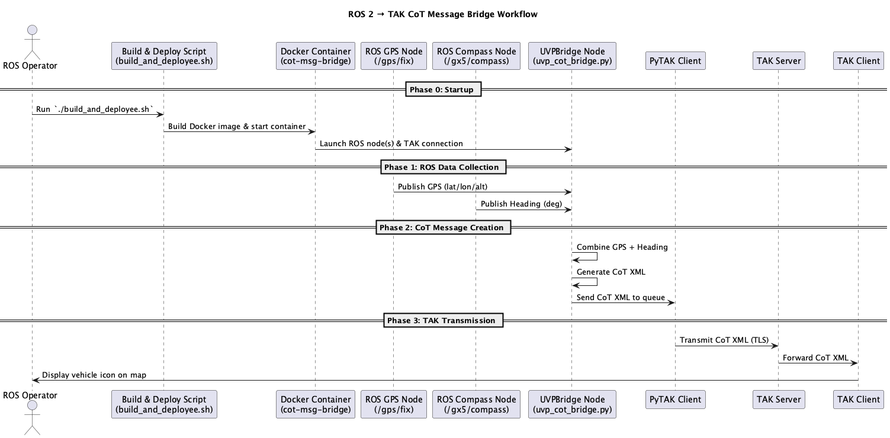

# **ROS 2 → TAK CoT Message Bridge**

## **Summary**

The **TAK bridge** between a ROS 2 system and a **TAK server** (ATAK / WinTAK / ITAK/ WebTAK).
It listens to **NavSatFix GPS** and **compass heading** topics in ROS 2, converts the data into **Cursor-on-Target (CoT)** XML messages, and sends them over the TAK server using the [pytak](https://github.com/ampledata/pytak) library.

This is useful for tracking Uncrew Vehicles (UGVs, UAVs, USVs, etc.) Positions in TAK while they operate within a ROS2 environment.

---

## **Mission Flow**

### **Data Flow**

```
ROS 2 Topics (GPS, Compass)
        ↓
uvp_cot_bridge.py (UVPBridge Node)
        ↓
CoT XML Message (Cursor-on-Target format)
        ↓
TAK Client (pytak)
        ↓
TAK Server (ATAK / WinTAK)
```


1. **`uvp_cot_bridge.py`** subscribes to:

   * A GPS topic (`NavSatFix`) for position (lat/lon/hae)
   * A compass topic (`Float64`) for heading
2. It builds a **CoT message** containing:

   * UID (unique vehicle identifier)
   * Callsign (human-readable name)
   * Location, heading, accuracy values
3. The message is sent over TAK protocol to the server defined in **`config.yaml`**.

---

## **Example CoT Message**

A typical message generated by `UVPBridge` looks like this:

```xml
<event version="2.0" uid="ghost-unit" type="a-f-G-E-V"
       time="2025-08-01T12:00:00Z" start="2025-08-01T12:00:00Z"
       stale="2025-08-01T12:01:00Z" how="m-g">
  <point lat="38.8951" lon="-77.0364" hae="12.3"
         ce="10" le="10"/>
  <detail>
    <contact callsign="V60"/>
    <track speed="0.0" course="270.0"/>
  </detail>
</event>
```

---

### **Field Descriptions**

| Field                    | Meaning                                                 |
| ------------------------ | ------------------------------------------------------- |
| `uid`                    | Unique ID for this vehicle (from `config.yaml`)         |
| `type`                   | CoT type code (`a-f-G-E-V` = ground vehicle)            |
| `time`, `start`, `stale` | Event timing (UTC, ISO 8601)                            |
| `how`                    | How position was determined (`m-g` = machine-generated) |
| `lat`, `lon`, `hae`      | Latitude, longitude, altitude (ellipsoid height)        |
| `ce`                     | Circular error estimate (meters)                        |
| `le`                     | Linear error estimate (meters)                          |
| `callsign`               | Friendly name for the vehicle                           |
| `speed`                  | Speed in m/s                                            |
| `course`                 | Heading in degrees (0–359)                              |

---

## **Configuration**

### **`config.yaml`**

This file defines:

* **TAK connection parameters**
* **ROS topic subscriptions** per vehicle

Example:

```yaml
# TAK-Server Config
tak_connection:
  tak__parameters:
    COT_URL: "tls://127.0.0.1:8089"
    PYTAK_TLS_DONT_VERIFY: "True"
    PYTAK_TLS_CLIENT_CERT: "user1.p12"
    PYTAK_TLS_CLIENT_PASSWORD: "atakatak"

# Ghost Robotic Vision 60 (V60)
v60_publisher:
  ros__parameters:
    uid: "V60"
    callsign: "Ghost"
    pos_topic: "/gx5/gnss1/fix"
    compass_topic: "/gx5/compass"

  
# C-100 Drone
c100_publisher:
  ros__parameters:
    uid: "C100"
    callsign: "C100-Drone"
    pos_topic: "rlac_c100/global_position/raw/fix"
    compass_topic: "/gx5/compass"
```

---

## **Running the Bridge**

### **1. Using `build_and_deployee.sh`**

If you just want to run the bridge inside Docker without worrying about commands:

```bash
./build_and_deployee.sh
```

This will:

* Build the Docker image using `cotMsgs.dockerfile`

---

### **3. Running Bare-Metal (Without Docker)**

**Requirements:**

* ROS 2 Humble installed
* Python 3.10+
* `pytak`, `pyproj`, `cryptography` Python packages

```bash
cd takbridge
python3 uvp_cot_bridge.py
```

---

## **Project Structure**

```
h4h-drivers
├── build_and_deploy.sh      # Helper to build & run container
├── docker-compose.yml       # Compose service for running the bridge
├── dockerfiles
│   ├── cotMsgs.dockerfile   # Docker build environment for bridge
├── takbridge
│   ├── certs
│   │   └── files
│   │       ├── user1.p12
│   ├── config
│   │   └── config.yaml   # Connection + ROS topic configuration
│   ├── cot_icd.py
│   ├── README.md
│   ├── tak_config.py        # TAK connection setup
│   └── uvp_cot_bridge.py    # Main ROS→CoT bridge script
```

---

## **Troubleshooting**

| Problem                       | Possible Cause                                            |
| ----------------------------- | --------------------------------------------------------- |
| No CoT messages appear in TAK | Incorrect TAK server IP/port in `config.yaml`             |
| Cert errors                   | TLS cert not found or password mismatch                   |
| No GPS/compass data           | ROS topics names in `config.yaml` don't match your system |
| Multiple networks             | Set matching `ROS_DOMAIN_ID` in Docker and on host        |
